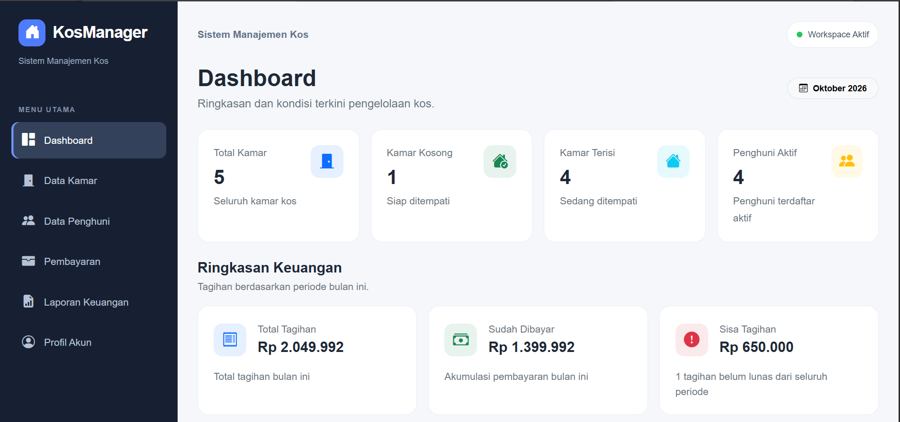

# KosManager — Sistem Manajemen Kos Berbasis Web

KosManager adalah aplikasi web untuk membantu pengelola rumah kos mengelola kamar, penghuni, tagihan, transaksi pembayaran, dan laporan keuangan dalam satu sistem terpusat.

Proyek ini dikembangkan sebagai portofolio pengembangan web dengan Laravel, PHP, dan MySQL.

**Demo:** https://izzaldev.com  
**Repository:** https://github.com/izzaldinrafee-ship-it/kosmanager

---

## Tampilan Aplikasi

### Dashboard



---

## Live Demo

Try KosManager online:

- **Website:** https://izzaldev.com
- **Demo account:** Use the demo credentials provided by the project owner.

### Demo Features

- Dashboard with room and payment summaries
- Room management
- Tenant management
- Billing and payment transactions
- Monthly financial reports

**Note:** This project is a portfolio demonstration. All demo data is fictional.

---

## Fitur Utama

- **Dashboard** — menampilkan ringkasan informasi dan statistik pengelolaan kos.
- **Manajemen Kamar** — mengelola data kamar dan status hunian.
- **Manajemen Penghuni** — mengelola informasi penghuni kos.
- **Manajemen Pembayaran** — mengelola tagihan pembayaran bulanan.
- **Riwayat Transaksi** — mencatat transaksi pembayaran dengan metode tunai, transfer, QRIS, dan e-wallet.
- **Status Pembayaran** — mendukung status Belum Bayar, Sebagian, dan Lunas.
- **Laporan Keuangan** — menyajikan ringkasan pembayaran dan informasi keuangan.
- **Profil Akun** — memungkinkan pengguna memperbarui informasi akun dan kata sandi.

## Teknologi

| Teknologi | Penggunaan |
|---|---|
| PHP | Bahasa pemrograman backend |
| Laravel | Framework aplikasi web |
| MySQL | Basis data relasional |
| Bootstrap 5 | Framework antarmuka |
| Bootstrap Icons | Ikon antarmuka |
| Vite | Build aset frontend |
| npm | Manajemen dependensi frontend |

## Instalasi Lokal

### 1. Persyaratan

Pastikan perangkat sudah memiliki:

- PHP dengan ekstensi yang dibutuhkan Laravel.
- Composer.
- MySQL.
- Node.js dan npm.
- Git.

### 2. Clone repository

```bash
git clone https://github.com/izzaldinrafee-ship-it/kosmanager.git
cd kosmanager
```

### 3. Instal dependensi PHP

```bash
composer install
```

### 4. Siapkan konfigurasi aplikasi

Untuk Windows Command Prompt:

```bat
copy .env.example .env
```

Untuk Linux atau macOS:

```bash
cp .env.example .env
```

Buat application key:

```bash
php artisan key:generate
```

### 5. Konfigurasi database

Buat database MySQL untuk lingkungan pengembangan, kemudian sesuaikan konfigurasi berikut di `.env`:

```dotenv
DB_CONNECTION=mysql
DB_HOST=127.0.0.1
DB_PORT=3306
DB_DATABASE=nama_database
DB_USERNAME=nama_user
DB_PASSWORD=password_database
```

Ganti nilai contoh di atas sesuai konfigurasi MySQL lokal.

### 6. Jalankan migrasi

```bash
php artisan migrate
```

### 7. Instal dan build aset frontend

```bash
npm install
npm run build
```

### 8. Jalankan aplikasi

```bash
php artisan serve
```

Buka aplikasi melalui:

http://127.0.0.1:8000

**Catatan:** Siapkan akun aplikasi menggunakan mekanisme pembuatan akun administrator yang dikonfigurasi untuk lingkungan pengembangan. Jangan menggunakan kredensial produksi pada lingkungan lokal.

## Deployment

Aplikasi ini telah dideploy ke hosting dengan konfigurasi produksi dan database MySQL.

- URL: https://izzaldev.com
- Environment: Production
- HTTPS: Aktif
- Debug mode: Dinonaktifkan

## Tujuan Pengembangan

Proyek ini menjadi sarana untuk menerapkan dan mendokumentasikan keterampilan dalam:

- Pengembangan aplikasi web menggunakan Laravel.
- Perancangan dan pengelolaan database relasional.
- Autentikasi dan pengelolaan akun pengguna.
- Implementasi alur pembayaran dan pencatatan transaksi.
- Deployment aplikasi web ke hosting.
- Pengelolaan source code menggunakan Git dan GitHub.

## Keamanan

- Jangan mengunggah file `.env`, password, token, atau kredensial database ke repository publik.
- Gunakan database terpisah untuk pengembangan dan produksi.
- Jangan menampilkan informasi error sensitif kepada pengguna produksi.
- Buat backup database secara berkala.
- Jangan memasukkan data pribadi penghuni kos ke screenshot atau dokumentasi publik.

---

**KosManager** — Boarding House Management System.
